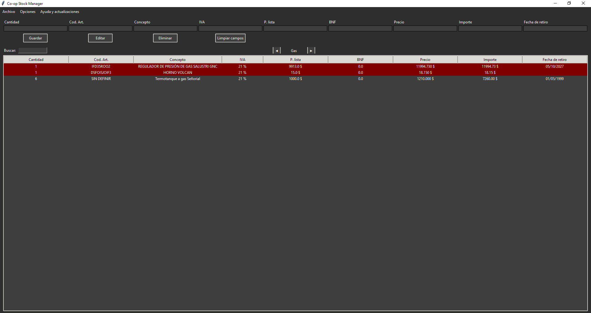

# Co-op Stock Manager

**Aplicación de escritorio para organizar y consultar el stock de materiales**, desarrollada en Python con Tkinter y SQLite.

Co-op Stock Manager nació como un proyecto personal para facilitar tareas de registro y seguimiento de artículos en un contexto cooperativo. Está orientado a un flujo de trabajo concreto, especialmente relacionado con materiales de **plomería, gas, electricidad y herramientas**, y no pretende ser un sistema de inventario universal ni un producto oficial de una cooperativa.

El proyecto se encuentra en desarrollo y ya se utiliza de manera puntual cuando resulta necesario. Su código fuente está disponible para consulta y adaptación de acuerdo con la licencia del repositorio.

## Captura de pantalla

Vista de la interfaz principal de Co-op Stock Manager.



## Funcionalidades

- **Gestión de artículos:** creación, consulta, edición y eliminación de registros con código, descripción, cantidad, precios, IVA, BNF y fecha de retiro.
- **Organización por categorías:** navegación entre *Plomería*, *Gas*, *Electricidad* y *Herramientas*.
- **Búsqueda y ordenación:** búsqueda por código o descripción, ordenación desde los encabezados de la tabla y reorganización manual de filas mediante arrastrar y soltar.
- **Cálculos de importes:** cálculo del precio a partir del precio de lista y el IVA, y del importe según la cantidad; visualización del valor total registrado.
- **Avisos visuales de stock bajo:** resaltado de registros cuya cantidad es inferior a cinco unidades.
- **Importación y exportación CSV:** importación de registros y exportación de todas las categorías, incluyendo su categoría y orden.
- **Exportación a PDF:** generación de un informe A4 horizontal con los artículos de la categoría seleccionada, sin mostrar la columna interna de orden. El archivo se guarda donde elijas y no se abre automáticamente.
- **Copias de seguridad:** creación manual de respaldos, restauración de archivos SQLite y respaldo automático al cerrar normalmente la aplicación.
- **Historial de cambios:** opciones para deshacer y rehacer operaciones durante la sesión (hasta 30 estados guardados para deshacer).
- **Interfaz adaptable:** modos claro y oscuro, ayuda integrada y comprobación de nuevas versiones publicadas en GitHub.

> **Alcance:** las categorías y algunas reglas de uso están definidas para las necesidades que motivaron el proyecto. No se han implementado como opciones configurables para cualquier tipo de negocio.

## Tecnologías utilizadas

| Tecnología | Uso en el proyecto |
| --- | --- |
| **Python** | Lógica principal de la aplicación. |
| **Tkinter / ttk** | Interfaz gráfica de escritorio. |
| **SQLite** | Persistencia local de los registros. |
| **pandas** | Lectura y procesamiento de datos, importación CSV e historial de cambios. |
| **ReportLab** | Generación de informes PDF por categoría. |
| **PyInstaller** | Generación de un ejecutable de Windows mediante el script de compilación incluido. |

Las dependencias declaradas por el proyecto se encuentran en [`requirements.txt`](requirements.txt).

## Instalación y ejecución desde el código fuente

### Requisitos

- **Windows** para seguir las instrucciones de compilación con `script_build.bat`.
- **Python 3** y `pip` instalados y disponibles en el equipo.
- **Git** si se utiliza el método de clonación; también es posible descargar el repositorio como ZIP desde GitHub.

No se ha establecido ni verificado una versión mínima específica de Python. La compatibilidad puede depender de las versiones de las dependencias instaladas.

### 1. Obtener el proyecto

Abrí **PowerShell** y ejecutá:

```powershell
git clone https://github.com/SrBenja/Co-op_Stock_Manager.git
cd Co-op_Stock_Manager
```

Si descargaste un ZIP, extraelo y abrí PowerShell en la carpeta que contiene `main.py`.

### 2. Crear un entorno virtual e instalar las dependencias

```powershell
py -m venv .venv
.\.venv\Scripts\python.exe -m pip install -r requirements.txt
```

El entorno virtual es recomendable para aislar las dependencias del proyecto. Si `py` no está disponible, se puede probar `python -m venv .venv`.

### 3. Iniciar la aplicación

```powershell
.\.venv\Scripts\python.exe main.py
```

Al iniciarse, la aplicación crea, cuando faltan, el archivo de base de datos `stock_co-op.db` y las carpetas `backup/` y `config/` junto al programa.

## Crear un ejecutable para Windows

El repositorio incluye [`script_build.bat`](script_build.bat), que utiliza **PyInstaller** para generar un archivo `.exe` de la aplicación.

Con las dependencias ya instaladas en el entorno virtual, y desde la carpeta del proyecto, podés ejecutar en **PowerShell**:

```powershell
cmd /c "call .venv\Scripts\activate.bat && call script_build.bat"
```

Este comando activa el entorno virtual dentro de una sesión de `cmd` y ejecuta el archivo por lotes. No requiere cambiar la política de ejecución de PowerShell.

Si el entorno virtual **ya está activado** en PowerShell, también podés usar directamente:

```powershell
.\script_build.bat
```

Al finalizar correctamente, el ejecutable esperado será:

```text
dist/
├── Co-op_Stock_Manager.exe
├── backup/
└── config/
```

**Importante:** `script_build.bat` elimina las carpetas `build/` y `dist/` preexistentes al comenzar y actualiza `pip` en el entorno desde el que se ejecuta. Guardá fuera de esas carpetas cualquier archivo que quieras conservar. El script **compila**, pero no inicia automáticamente el `.exe`, y no comprueba de forma explícita que PyInstaller haya terminado sin errores.

## Uso básico

1. Seleccioná una categoría con los controles de navegación.
2. Completá los datos de un artículo y utilizá **Guardar** para registrarlo.
3. Seleccioná una fila para editarla o eliminarla; utilizá la búsqueda para localizar artículos por código o descripción.
4. Desde **Archivo**, importá o exportá archivos CSV. La exportación CSV incluye todas las categorías; la importación **agrega** registros y no reemplaza automáticamente los existentes.
5. Seleccioná **Archivo → Exportar a PDF** para guardar un informe de la categoría que estés viendo. El documento se guarda sin abrirse automáticamente.
6. Desde **Opciones**, creá o restaurá una copia de seguridad, o cambiá entre los temas claro y oscuro.

La ventana **Ayuda y actualizaciones → Cómo funciona** incluye información adicional sobre el manejo de la aplicación y sus atajos.

## Archivos de datos y copias de seguridad

La aplicación almacena sus datos **localmente**, en el directorio desde el que se ejecuta `main.py` o en la carpeta que contiene el `.exe`:

| Archivo o carpeta | Contenido |
| --- | --- |
| `stock_co-op.db` | Base de datos SQLite con los registros del stock. |
| `backup/` | Copias de la base de datos con fecha y hora en el nombre. |
| `config/config.json` | Preferencias de la aplicación y configuración para consultar actualizaciones. |

El respaldo automático se realiza al **cerrar normalmente** la ventana de la aplicación. No sustituye una estrategia de copias externas ni garantiza recuperar datos después de un cierre inesperado. Evitá subir a un repositorio público bases de datos o configuraciones que puedan contener información privada.

## Estado del proyecto

**Proyecto personal en desarrollo.** La versión preparada actualmente en `main.py` es `v0.1.1`. Esta actualización añade la categoría **Herramientas**, mejora la exportación de informes PDF y corrige la comparación de versiones del sistema de actualizaciones.

La opción **Archivo → Exportar a PDF** genera el informe de la categoría activa, sin abrir el archivo después de guardarlo. La generación del PDF fue probada en Windows. El resto de las funcionalidades puede seguir recibiendo mejoras y correcciones.

## Licencia

Este repositorio se distribuye bajo la **GNU General Public License v3.0 (GPL-3.0)**. Consultá el archivo [`LICENSE`](LICENSE) para conocer los términos aplicables.

---

Desarrollado y mantenido por [SrBenja](https://github.com/SrBenja).
